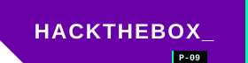
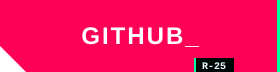

<!--
  Save this README.md AND the assets/ folder in a PUBLIC repo named exactly: netromacer/netromacer
  Palette (Cyberpunk SCARLET): bg #000807 | scarlet #ff3270 | red #ff0059 | cyan #00c3ff | bright cyan #89ddff | green #00ff9c | purple #b700ff | white #eeffff
-->

<!-- Optional: drop your own artwork (logo, mask, anything) into the repo and uncomment:

-->

- 🔴 Into **offensive security** and **penetration testing**
- 🛡️ Interested in **cyber-security** in general
- 🧪 Building and documenting projects as I learn
- 🎮 Here for the fun too: CTFs, labs, home-lab experiments and odd side projects

<!-- To add a project: copy a project-*.svg in assets/, edit the title / description / chips / stamp text inside it, and link it below. -->

- 🏴 **CTFs**: playing and writing up challenges
- 🖥️ **Home lab**: vulnerable VMs, networks and break-it-then-fix-it experiments
- 📝 **Write-ups**: notes on labs and machines I've worked through
- 🎯 **Platforms**: [Hack The Box](https://app.hackthebox.com/) · [TryHackMe](https://tryhackme.com/) · [PortSwigger Academy](https://portswigger.net/web-security)

<!-- Add whichever you use:

-->

 

⚠️ Everything here is for learning and authorised testing only. I am hacking ethically and legally. I don't want to go to jail man 💀.

